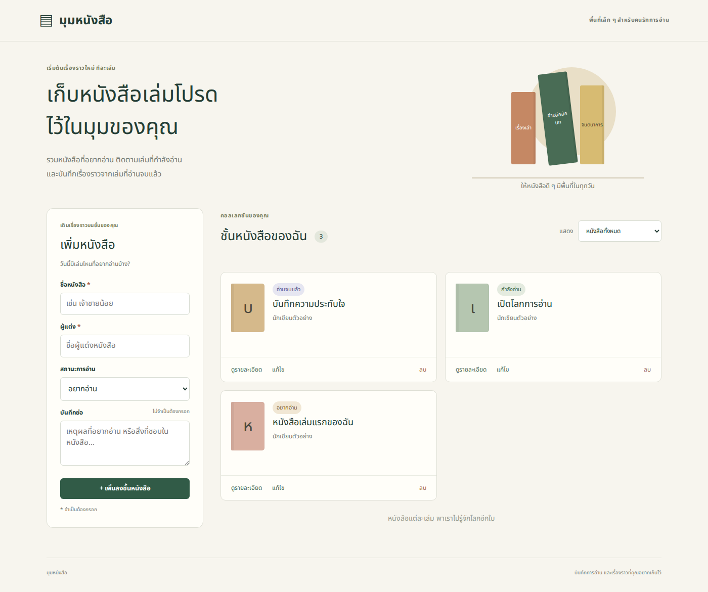
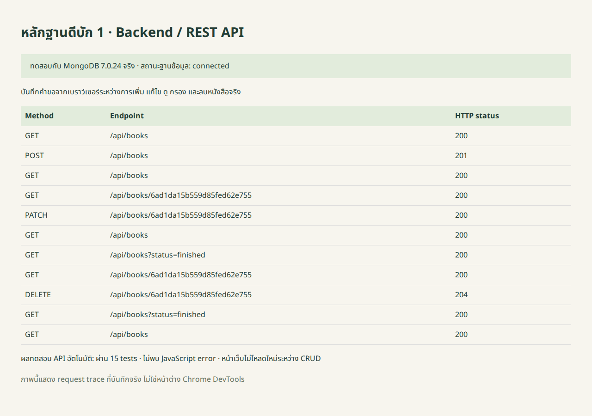
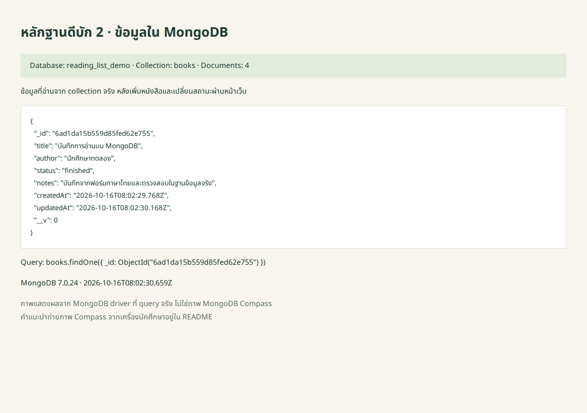

# 📚 มุมหนังสือ — Reading List + MongoDB

เว็บแอปภาษาไทยสำหรับบันทึกหนังสือที่อยากอ่าน กำลังอ่าน และอ่านจบแล้ว ผู้ใช้เพิ่ม ดูรายละเอียด แก้ไข ลบ และกรองหนังสือได้โดยไม่ต้องรีเฟรชหน้า

เวอร์ชัน 2.0 ใช้ **MongoDB เก็บข้อมูลจริง** ติดต่อผ่าน Mongoose และ Express REST API หน้าเว็บใช้ HTML, CSS และ JavaScript เรียก API ของแอปด้วย `fetch()` ไม่เรียก API หนังสือภายนอก ไม่มีระบบสมาชิก



## วิธีติดตั้งและรัน

ต้องติดตั้ง Node.js และเปิด MongoDB Server ก่อน จากนั้นเปิด CMD ในโฟลเดอร์โปรเจกต์ แล้วรัน:

```bat
npm install
copy .env.example .env
npm run dev
```

เปิดเว็บไซต์ที่ http://localhost:3000

หากต้องการเพิ่มข้อมูลหนังสือตัวอย่าง ให้รัน `npm run seed`

## ตรวจข้อมูลใน MongoDB Compass

1. เปิด Compass แล้วเชื่อมต่อ `mongodb://127.0.0.1:27017`
2. รัน `npm run seed` หรือเพิ่มหนังสือผ่านเว็บอย่างน้อยหนึ่งเล่ม
3. กด Refresh ใน Compass แล้วเปิด **reading_list → books → Documents**
4. จะพบ `_id`, `title`, `author`, `status`, `notes`, `createdAt` และ `updatedAt`
5. ลองแก้ไขสถานะในเว็บ แล้ว Refresh ใน Compass ตรวจว่า document เดิมเปลี่ยนจริง
6. ลบหนังสือในเว็บ แล้ว Refresh ตรวจว่า document นั้นหายไป

ฐานข้อมูลและ collection จะปรากฏหลังมีการเขียนข้อมูลครั้งแรก ไม่ต้องสร้างด้วยมือ

## โครงสร้างโปรเจกต์

```text
reading-list/
├── server/
│   ├── index.js          เปิด Express หลังเชื่อมต่อ MongoDB สำเร็จ
│   ├── database.js       ตั้งค่าการเชื่อมต่อ MongoDB
│   ├── app.js            REST routes, validation และ error handling
│   └── models/
│       └── Book.js       Mongoose schema และ model
├── public/
│   ├── index.html        หน้าเว็บภาษาไทย
│   ├── style.css         CSS รองรับจอคอมพิวเตอร์และมือถือ
│   ├── app.js            fetch และอัปเดต DOM
│   └── fonts/            ฟอนต์ไทยพร้อมใบอนุญาต
├── scripts/
│   ├── seed.js           เพิ่มข้อมูลตัวอย่างลง MongoDB
│   └── import-json.js    ย้ายข้อมูลจากเวอร์ชัน JSON เดิม (ทางเลือก)
├── data/books.json       ตัวอย่าง JSON เดิมสำหรับ import เท่านั้น
├── tests/api.test.js     ทดสอบ API กับ mongod ชั่วคราวแยกจากข้อมูลผู้ใช้
├── docs/
│   ├── screenshots/      ภาพใช้งานและดีบักจริง
│   ├── api-test-results.txt
│   ├── browser-test-results.json
│   └── database-evidence.json
├── .env.example          ตัวอย่างค่าการเชื่อมต่อ ไม่มีรหัสผ่านจริง
├── .gitignore
├── package.json
├── package-lock.json
└── README.md
```

## ความสามารถและวิธีใช้

- **เพิ่มหนังสือ:** กรอกชื่อหนังสือ ผู้แต่ง สถานะ และบันทึกย่อ แล้วกด “เพิ่มลงชั้นหนังสือ”
- **ดูรายละเอียด:** กด “ดูรายละเอียด” เพื่อเรียกข้อมูลหนังสือเล่มเดียวจาก API
- **แก้ไข:** กด “แก้ไข” เปลี่ยนข้อมูล แล้วกด “บันทึกการแก้ไข”
- **ลบ:** กด “ลบ” แล้วกด “ยืนยันลบหนังสือ”
- **กรอง:** เลือกหนังสือทั้งหมด / อยากอ่าน / กำลังอ่าน / อ่านจบแล้ว
- หลังทำรายการจะเรียก GET เพื่ออัปเดต DOM โดยไม่โหลดหน้าใหม่ ตัวกรองเดิมยังทำงาน ถ้าหนังสือไม่ตรงสถานะที่เลือก รายการนั้นจะไม่ปรากฏ
- หากโหลดข้อมูลไม่สำเร็จ มีข้อความภาษาไทยและปุ่ม “ลองอีกครั้ง”

## ฐานข้อมูลและ Schema

Database: `reading_list` · Collection: `books`

| ฟิลด์ใน MongoDB | ชนิด | เงื่อนไข |
|---|---|---|
| `_id` | ObjectId | MongoDB สร้างให้ แก้ผ่าน API ไม่ได้ |
| `title` | String | บังคับ 1–120 ตัวอักษรหลัง trim |
| `author` | String | บังคับ 1–80 ตัวอักษรหลัง trim |
| `status` | String | `want-to-read`, `reading`, `finished`; ค่าเริ่มต้น `want-to-read` |
| `notes` | String | ไม่บังคับ ไม่เกิน 1,000 ตัวอักษร ค่าเริ่มต้น `""` |
| `createdAt` | Date | Mongoose สร้างเวลาบันทึกครั้งแรก |
| `updatedAt` | Date | Mongoose อัปเดตเวลาแก้ไข |

API ส่ง `_id` ออกมาในชื่อ **`id` แบบ string** เพื่อให้หน้าเว็บใช้งานได้เหมือนเดิม ส่วน Compass จะแสดง `_id` แบบ ObjectId เวลาที่ส่งผ่าน JSON เป็น ISO date string

มี index `{ status: 1, createdAt: -1 }` สำหรับการกรองตามสถานะและเรียงเวลาเพิ่มล่าสุด

## REST API — endpoint ทั้งหมด

Base URL: `http://localhost:3000` · Body ใช้ `Content-Type: application/json`

| Method | Endpoint | หน้าที่ | สำเร็จ | กรณีผิดพลาดหลัก |
|---|---|---|---|---|
| GET | `/api/health` | ตรวจสถานะฐานข้อมูล | 200 + object | 503 ฐานข้อมูลไม่พร้อม |
| GET | `/api/books` | ดึงหนังสือทั้งหมด เรียงเพิ่มล่าสุดก่อน | 200 + array | 503 ฐานข้อมูลไม่พร้อม |
| GET | `/api/books?status=reading` | กรองตามสถานะการอ่าน | 200 + array; ไม่พบคืน `[]` | 400 ค่า filter ไม่ถูกต้อง |
| GET | `/api/books/:id` | ดึงหนังสือเล่มเดียว | 200 + object | 404 ไม่พบหรือรูปแบบ ID ไม่ถูกต้อง |
| POST | `/api/books` | เพิ่มหนังสือ | 201 + object + Location header | 400 ข้อมูลไม่ครบหรือไม่ถูกต้อง |
| PATCH | `/api/books/:id` | แก้เฉพาะฟิลด์ที่ส่งมา | 200 + object | 404 ไม่พบ; 400 ข้อมูลไม่ถูกต้อง |
| DELETE | `/api/books/:id` | ลบหลังผู้ใช้ยืนยันในหน้าเว็บ | 204 ไม่มี response body | 404 ไม่พบ |

ทุก endpoint ที่ใช้ฐานข้อมูลอาจคืน 503 เมื่อการเชื่อมต่อขาดหาย หรือ 500 เมื่อเกิดข้อผิดพลาดภายในอื่น ๆ

POST ต้องมี `title` และ `author` ส่วน PATCH ต้องมีอย่างน้อยหนึ่งฟิลด์ที่อนุญาต ระบบตรวจชนิดข้อมูล ความยาว และสถานะ ไม่รับ `_id`, `id`, timestamps หรือ MongoDB update operators จาก request

JSON ผิดรูปแบบหรือไม่ใช่ object คืน 400; body เกิน 32 KB คืน 413; endpoint `/api/...` ที่ไม่มีคืน 404

### ตัวอย่าง POST

```http
POST /api/books
Content-Type: application/json
```

```json
{
  "title": "หนังสือเล่มโปรด",
  "author": "ผู้แต่งตัวอย่าง",
  "status": "want-to-read",
  "notes": "อยากอ่านในวันหยุด"
}
```

ตัวอย่าง response 201 (ID และเวลาจริงสร้างโดยฐานข้อมูล):

```json
{
  "id": "507f1f77bcf86cd799439011",
  "title": "หนังสือเล่มโปรด",
  "author": "ผู้แต่งตัวอย่าง",
  "status": "want-to-read",
  "notes": "อยากอ่านในวันหยุด",
  "createdAt": "2026-10-16T07:00:00.000Z",
  "updatedAt": "2026-10-16T07:00:00.000Z"
}
```

### ตัวอย่าง PATCH และ DELETE

```http
PATCH /api/books/<id-ที่ได้จาก-POST>
Content-Type: application/json
```

```json
{"status":"finished"}
```

```http
DELETE /api/books/<id-ที่ได้จาก-POST>
```

DELETE สำเร็จส่ง 204 จึงไม่เรียก `response.json()` ใน frontend

ตัวอย่าง error 404:

```json
{"error":"ไม่พบหนังสือเล่มนี้"}
```

## หลักฐานดีบัก 2 ภาพ

ภาพต่อไปนี้ได้จากการทดสอบชุด MongoDB รุ่นนี้จริง ใช้ฐานข้อมูลทดสอบแยกจากเครื่องผู้ใช้ ไม่ใช่ผลจากเวอร์ชัน JSON เดิม

### ภาพที่ 1 — Backend / REST API

บันทึก response events จากเบราว์เซอร์ระหว่างกดปุ่มจริง เห็น POST 201, PATCH 200, GET 200 และ DELETE 204



ผลทดสอบ API ฉบับเต็ม: [api-test-results.txt](docs/api-test-results.txt) · ผลทดสอบหน้าเว็บ: [browser-test-results.json](docs/browser-test-results.json)

### ภาพที่ 2 — document ใน MongoDB

ข้อมูลที่อ่านด้วย `collection.findOne()` จาก MongoDB จริง หลังเพิ่มและแก้ไขผ่านหน้าเว็บ เห็นชื่อหนังสือภาษาไทย ObjectId และ timestamps



ข้อมูลหลักฐาน: [database-evidence.json](docs/database-evidence.json)

**ภาพนี้เป็นหน้าสรุปผล query จริง ไม่ใช่หน้าต่าง MongoDB Compass และภาพแรกไม่ใช่ Chrome DevTools โดยตรง** หากอาจารย์กำหนดให้เป็นภาพ DevTools และ Compass ให้ถ่ายจากเครื่องตนเองตามขั้นตอนด้านล่าง แล้วแทนที่ไฟล์ภาพเดิม ชื่อไฟล์เดิมจะทำให้ README แสดงภาพใหม่ได้ทันที

### ถ่ายภาพจากเครื่องตนเองก่อนส่งงาน

1. ภาพ Backend: เปิดเว็บ กด F12 → Network → Fetch/XHR แล้วเพิ่มหรือแก้หนังสือ เลือกคำขอ `/api/books` ให้เห็น Method, Status Code และ Response จับภาพแล้วบันทึกทับ `docs/screenshots/debug-1-backend-api.png`
2. ภาพ MongoDB Compass: เปิด `reading_list → books → Documents` ให้เห็น document ที่เพิ่มผ่านเว็บ รวมทั้งชื่อฐานข้อมูลและ collection จับภาพบันทึกทับ `docs/screenshots/debug-2-mongodb.png`
3. Commit และ Push ภาพใหม่พร้อม README ไป GitHub

## ทดสอบ API อัตโนมัติ (ทางเลือก)

```bat
npm test
```

ใช้ `mongodb-memory-server-core` เปิด **MongoDB Server จริงใน process ชั่วคราว** ไม่ใช่ mock แล้วทดสอบ CRUD, validation, filter, Thai text, persistence หลัง reconnect, 404, 400, 413 และกรณีฐานข้อมูลขาดการเชื่อมต่อ 503

ไม่อ่าน `.env` และไม่ใช้ฐานข้อมูลผู้ใช้ใน tests การทดสอบครั้งแรกต้องมีอินเทอร์เน็ตเพื่อดาวน์โหลด MongoDB 7.0.24 มาที่ cache เครื่อง ส่วนการรันเว็บตามปกติใช้ MongoDB Server ที่ตั้งค่าใน `.env` ไม่ได้ใช้ test server นี้

ผลรันที่แนบ: Node.js 24.19.0 + MongoDB 7.0.24 ผ่าน 15 tests ตามตัวนับของ Node (14 กรณีย่อย + 1 parent test) ไม่มี failure ตรวจหน้าเว็บภาษาไทยและการจัดวางที่ความกว้าง 390 px แล้วด้วย

## ย้ายข้อมูลจากเวอร์ชัน JSON เดิม (ทางเลือก)

แอปไม่อ่าน JSON ระหว่างใช้งาน หากต้องการย้ายหนังสือเก่า ให้สำรองไฟล์ `data/books.json` เดิมก่อน จากนั้นรันในโฟลเดอร์โปรเจกต์:

```bat
npm run import:json -- "C:\path\to\old-project\data\books.json"
```

หากไม่ระบุ path จะใช้ไฟล์ตัวอย่าง `data/books.json` ที่แนบมา คำสั่งอ่านไฟล์เก่าอย่างเดียวและเขียนเข้า MongoDB เท่านั้น ไม่แก้ไฟล์ต้นฉบับ สร้าง ObjectId ใหม่แทน ID เดิม และข้ามรายการที่มีชื่อกับผู้แต่งตรงกัน เพื่อไม่เขียนทับข้อมูลปัจจุบัน หากไฟล์เดิมมีหนังสือชื่อและผู้แต่งเหมือนกันหลายรายการ จะย้ายเป็นรายการเดียว

## ปัญหาที่พบบ่อย

| อาการ | วิธีตรวจ |
|---|---|
| `MongoDB connection failed` | เปิด MongoDB Server ตรวจ URI ใน `.env` และลองเชื่อมต่อ URI เดียวกันใน Compass |
| มี Compass แต่เชื่อมต่อไม่ได้ | ตรวจว่าติดตั้งและเปิด MongoDB Server อยู่ Compass อย่างเดียวไม่ได้เปิด database server |
| เข้าเว็บไม่ได้ | เปิด Terminal ค้างไว้ ตรวจว่ามีข้อความ URL หลัง MongoDB connected |
| Port 3000 ถูกใช้ | เปลี่ยน `PORT=3001` ใน `.env` แล้วเปิดเว็บที่ port 3001 |
| ไม่เห็น reading_list ใน Compass | เพิ่มหนังสือหรือรัน seed ก่อน แล้วกด Refresh |
| หนังสือเพิ่มแล้วไม่เห็น | เปลี่ยนตัวกรองเป็น “หนังสือทั้งหมด” |
| ID b1/b2 จากรุ่นเดิมใช้ไม่ได้ | รุ่น MongoDB ใช้ ObjectId ให้ดึง ID ปัจจุบันจาก GET /api/books |


